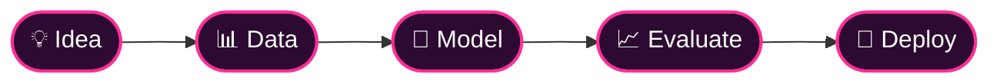

<!-- ═════════ HEADER ═════════ -->


<div align="center">

<a href="https://github.com/Palak-1612">
  
</a>

<br/><br/>


</div>

<div align="center">

```
┌────────────────────────────────────────────┐
│  > booting palak.exe ...                   │
│  > loading python ............. [ OK ]     │
│  > loading machine learning ... [ OK ]     │
│  > status: learning & building_            │
└────────────────────────────────────────────┘
```

</div>

---

## 🎧 `whoami`

I'm **Palak**, a Computer Science student who loves Python, Machine Learning, and AI. I turn data and ideas into working projects, and I'm learning something new every day.

```python
class Palak:
    def __init__(self):
        self.name      = "Palak Singh"
        self.pronouns  = "she/her"
        self.role      = "Computer Science Student"
        self.focus     = ["Machine Learning", "Deep Learning", "Data Science"]
        self.fuel      = "lofi beats + chai ☕ + curiosity"
        self.mantra    = "Learn. Build. Break. Repeat."

    def currently(self):
        return {
            "🔭 working on": "AI/ML projects & improving my GitHub game",
            "🌱 learning":   "Deep Learning, model deployment",
            "🎯 goal":       "ML internship & real-world AI projects",
        }
```

---

## 🛠️ Tech Arsenal

<div align="center">


</div>

---

## 🧭 How I Build

<div align="center">



</div>

---

## 🚀 Featured Project

<div align="center">

<a href="https://github.com/Palak-1612/Movie-Recommendation-System">
  
</a>

</div>

> 💡 More projects coming soon. Stay tuned!

---

## 📊 GitHub Stats

<div align="center">


<br/>


</div>

---

## 🌸 Fun Facts

- 🎧 My best code always happens with headphones on
- 🐛 Debugging = 10% fixing, 90% "wait, how was this even working?"
- 📚 Currently obsessed with turning ideas into working models

---

<div align="center">

### let's build something.

[](https://linkedin.com/in/palak-singh-45974a387)
[](mailto:palaksingh22d@gmail.com)

</div>


